# k8s-installer-tui
To set up a Kubernetes cluster with a terminal UI. Thanks to these two amazing projects:
- [Kubespray](https://github.com/kubernetes-sigs/kubespray)
- [Tview](https://github.com/rivo/tview)

## Features
- Create a new k8s cluster, or add nodes to an existing cluster
- Auto-assign nodes to control plane or etcd role
- Edit node labels and taints
- Auto-open necessary firewall rules on each node (firewalld or ufw)
- Feature toggles: NTP, containerd registry mirrors, k8s-node-watcher, CSI snapshot controller, NFS client, and gvisor
- Select cluster HA mode: localhost load balancing, or kube-vip
- Configure the service and pod CIDRs and run sampled IP-conflict checks
- Enable a public download mirror to speed up downloads in China
- Auto-create an SSH key and copy it to each node
- Generate a reusable installation config from the wizard with `--create`
- Support offline install
  - Run the following commands to prepare the offline install materials:
    ```shell
    mkdir -p ~/k8s-installer-offline
    cd ~/k8s-installer-offline
    curl -L -o podman https://github.com/xinnj/podman-launcher/releases/download/1.0.1/podman-launcher-amd64
    chmod +x podman
    ./podman pull docker.io/xinnj/kubespray-runtime:2.29.1
    ./podman save docker.io/xinnj/kubespray-runtime:2.29.1 -o docker.io_xinnj_kubespray-runtime-2.29.1.tar
    ```

## Installation
Download the release package, unpack it on a Linux host, and run `k8s-installer-tui` as root.

Requirements: Linux with root or passwordless sudo, a terminal, `config.yaml` and a `kubespray-*.tar.gz` archive next to the binary, and Podman (or network access so the bundled `podman-launcher` can be downloaded).

## Config-driven (unattended) installation
Instead of stepping through the wizard, a single YAML file can supply the answers and start the
installation:

```shell
./k8s-installer-tui --config cluster.yaml
./k8s-installer-tui --config cluster.yaml --dry-run
```

`--dry-run` runs the same validation, project generation, and IP-conflict check,
then opens the prefilled wizard on the Deploy page with Start disabled. It does
not copy SSH keys, SSH into nodes, or run Ansible; review the pages and quit.

The config file is separate from the installer's own `config.yaml` (the one that
defines features and mirrors). See [`install.example.yaml`](install.example.yaml);
only `hosts` and either `ssh.password` or `ssh.key_file` are required. Omitted
values fall back to the wizard defaults: localhost HA, flannel, Kubespray's
service/pod CIDRs, no mirror, and the `config.yaml` feature defaults.

`hosts` accepts two shapes:

- bare entries (`10.0.0.11`, `10.0.0.12-10.0.0.14`, `10.0.0.15,192.168.1.15`) —
  roles are assigned automatically by the same inventory builder the wizard uses;
- detailed host objects with `roles` (`control-plane`, `etcd`, `node`,
  `calico_rr`) — no other roles are added; aliases such as `master` and `worker`
  are normalized to the canonical names.

The YAML contains plaintext SSH credentials; keep it `chmod 600` (the installer
warns when it is readable by other users). Run as root or with passwordless
sudo, on a terminal: the wizard and live log remain visible. Re-running reuses
the project directory, regenerates `hosts.yaml`/`extra-vars.yaml`, and keeps the
generated `ansible-key`. Only one installer run should target the same host at a time.

When the run ends, the TUI exits and its screen is cleared, so the console then
prints an `Installation result` block: result, exit code, duration, project,
log file path, the host problems from the last PLAY RECAP, the last error line,
and the last 20 lines of the log. The same log stays on disk at the printed
path.

Exit codes: `0` success (or dry-run reviewed), `1` preflight/conflict/SSH/playbook
failure, `2` usage or config error, `130` SIGTERM.

Current limits: IPv4 only; one `ssh.user` for all hosts; an existing key file
cannot have a passphrase; `extra_vars` is merged last and bypasses config
validation.

## Generate a config from the wizard (--create)
The wizard can also write the installation file used by `--config`:

```shell
./k8s-installer-tui --create                     # writes ./install.yaml
./k8s-installer-tui --create -c cluster.yaml     # writes cluster.yaml
```

It walks the same pages (Setup Mode → Project → Edit Hosts → Features → HA
Mode → Network → Mirror) and ends on **Save Config**. The Add Nodes entry is
disabled; `--create` writes a new-cluster file. The Network page's conflict
checkbox is recorded as `network.check_conflicts`, but no sampled ping runs.
No SSH key is generated or copied, no node is contacted, and no playbook runs.

The Save Config page records either an SSH password or an existing key file
(plus a sudo password for a non-root user) and writes detailed hosts with their
exact roles, labels, and taints. The file is written with mode `0600`, and an
existing file is only replaced after confirmation. `-c/--config` names the
output file in this mode, defaulting to `install.yaml`; the Output file field on
the Save Config page can change it.

`--create` still runs the preflight (root or passwordless sudo, Podman, the
Kubespray archive) because creating or loading a project uses the container.
`--create --dry-run` is rejected because nothing is installed. Exit codes: `0`
after a successful write or a quit, `1` if the preflight fails, `2` for a usage
or `config.yaml` error.

The generated file can be reviewed and run with:

```shell
./k8s-installer-tui --config install.yaml --dry-run
./k8s-installer-tui --config install.yaml
```

`--create` always writes the detailed host shape; arbitrary `extra_vars` are
not editable in this flow (use the Features page or edit the file afterward).

## Usage
### Select setup mode


### Create a new k8s cluster

#### New or load a project

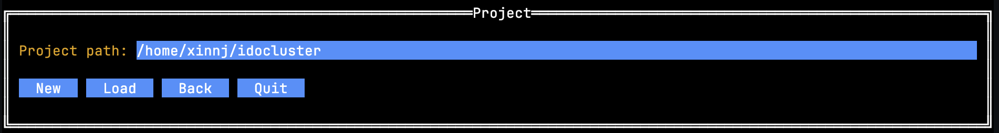

#### New project

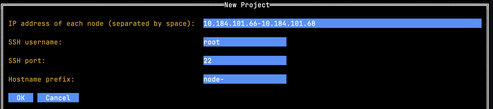

Each node is assigned a role according to [Cluster size and roles](#cluster_size_and_roles).

#### Edit hosts

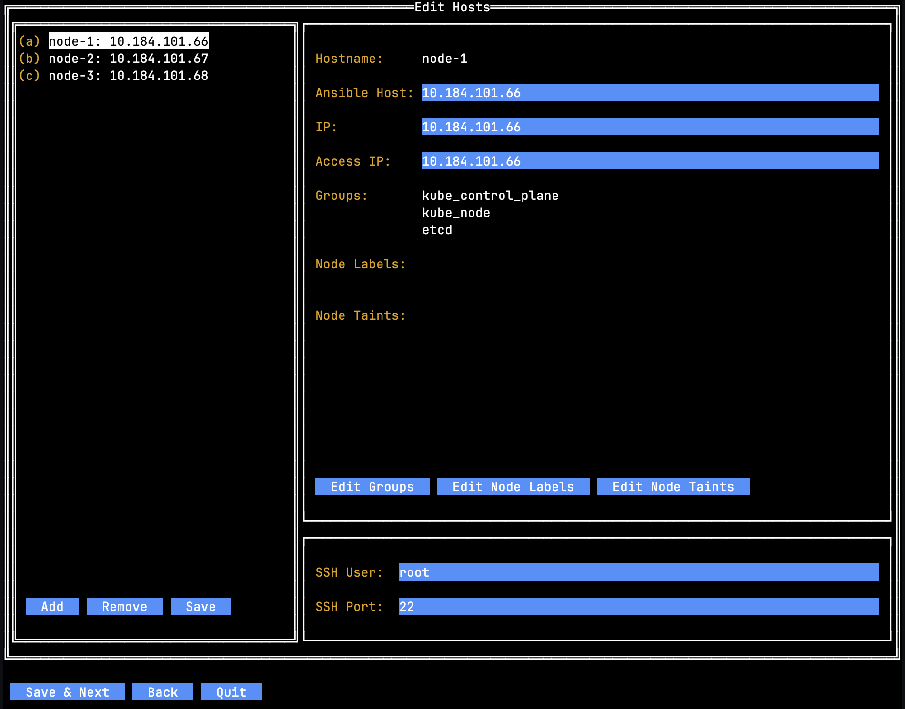

#### Edit group

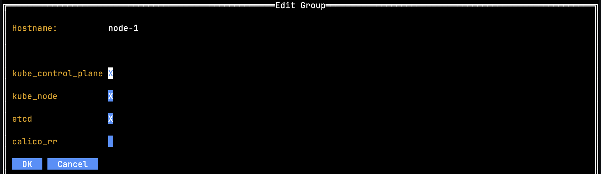

#### Edit node labels

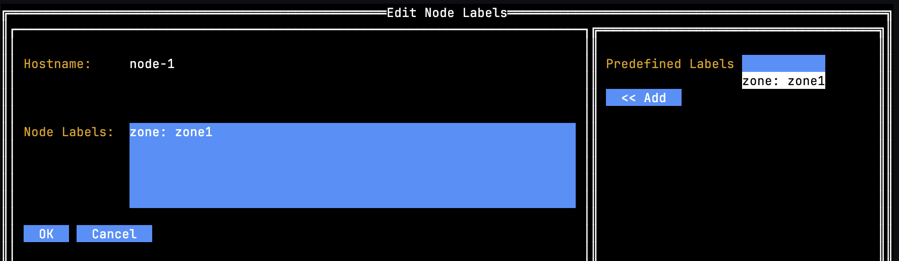

Labels can be selected from the predefined list or entered directly, one per line.

#### Edit node taints

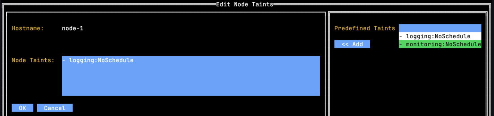

#### Set features

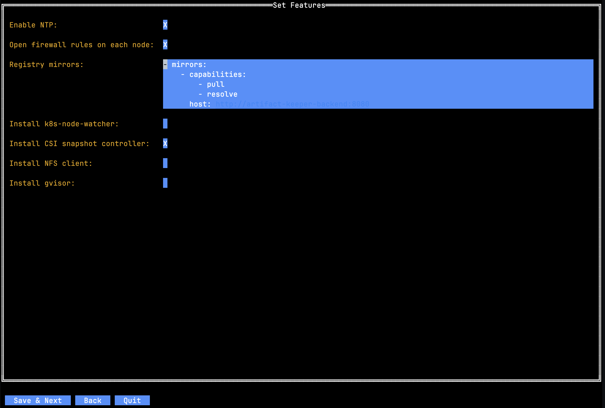

#### Set HA mode

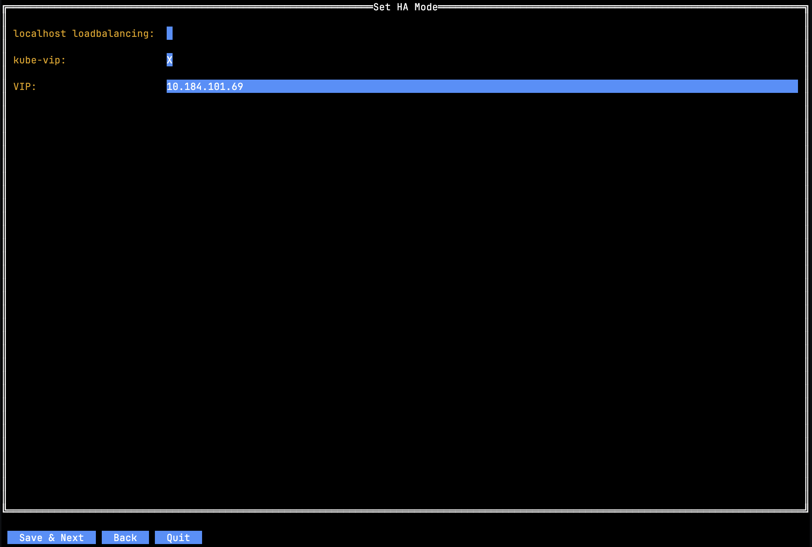

#### Network

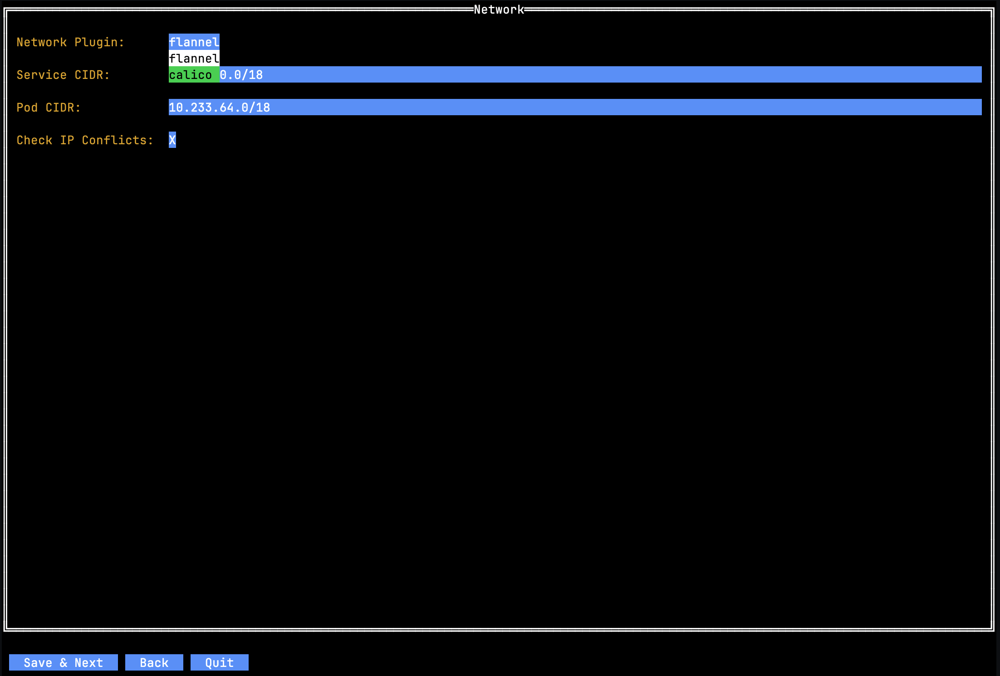

Five sampled IPs from each CIDR are pinged from the host running the installer to detect conflicts.

#### Public download mirror

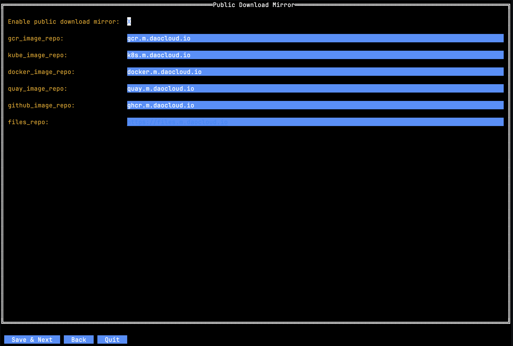

Thanks to [DaoCloud](https://github.com/DaoCloud/public-image-mirror).

#### Final check

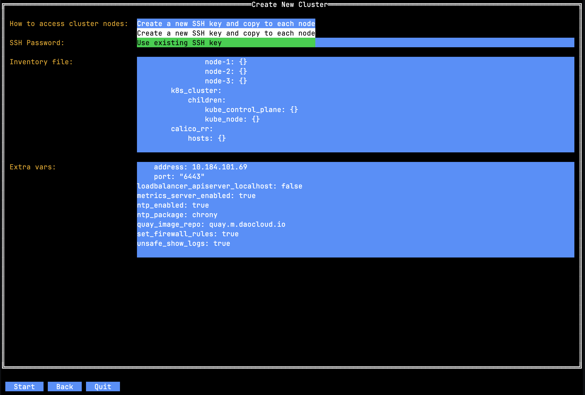

Review the inventory file and extra vars, or edit them directly. The nodes' SSH credentials (plus the sudo password for a non-root user) are required once everything is correct.

#### Start to setup

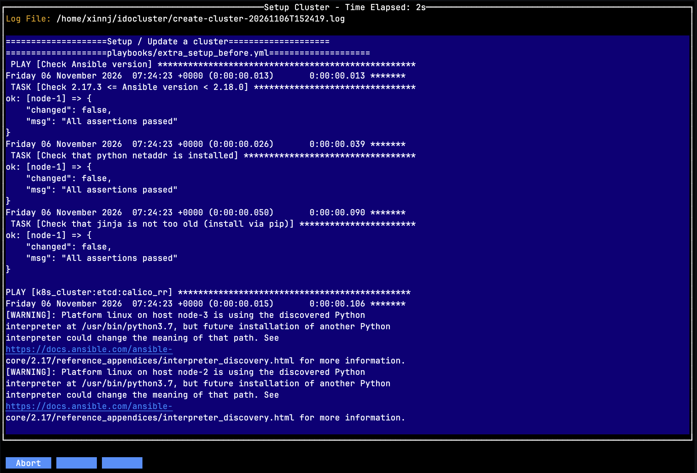

The execution log is stored in the file whose path is shown at the top of the window; its content also scrolls in the window.

#### Setup result

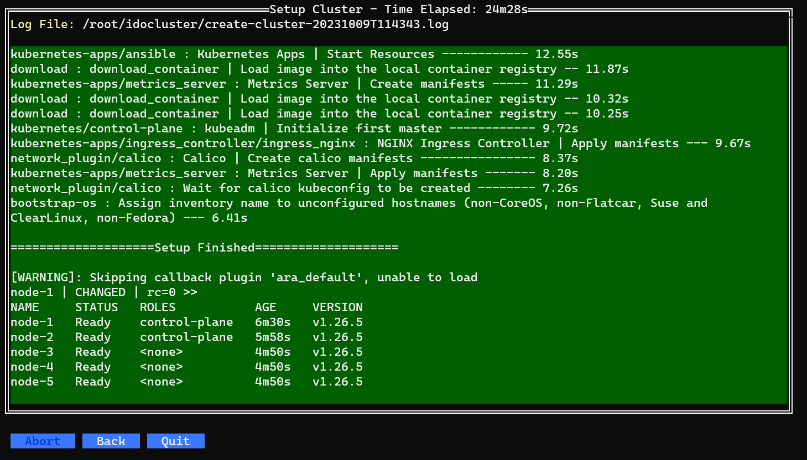

The background turns green on success and red on failure.

### Add nodes to existing cluster

#### Load existing project

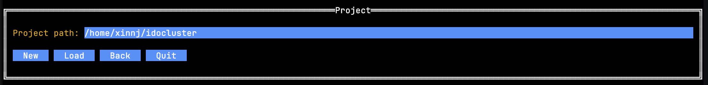

#### Add host

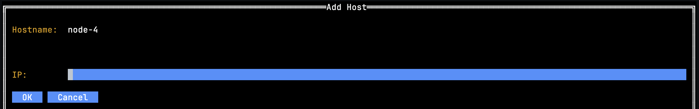

The role of a newly added host is assigned according to [Cluster size and roles](#cluster_size_and_roles).

### <a id="cluster_size_and_roles"></a>Cluster size and roles

|  Cluster Size  |           node1           |         node2         |           node3           |     node4 and others      |
|:--------------:|:-------------------------:|:---------------------:|:-------------------------:|:-------------------------:|
|       1        |   control-plane<br>etcd   |
|       2        |   control-plane<br>etcd   |    control-plane      |
|       3        |   control-plane<br>etcd   | control-plane<br>etcd | worker (`kube_node`)<br>etcd |
| 4<br>and above |   control-plane<br>etcd   | control-plane<br>etcd | worker (`kube_node`)<br>etcd | worker (`kube_node`) |

Below 50 hosts, every host is also in `kube_node`, so control-plane nodes are schedulable workers too. At 50 hosts and above, the roles separate: the first three hosts are `etcd` (and `calico_rr`) only, hosts 4-5 are `kube_control_plane`, and the remaining hosts are `kube_node`; at 200 hosts and above, hosts 4-5 also leave `kube_node`.
